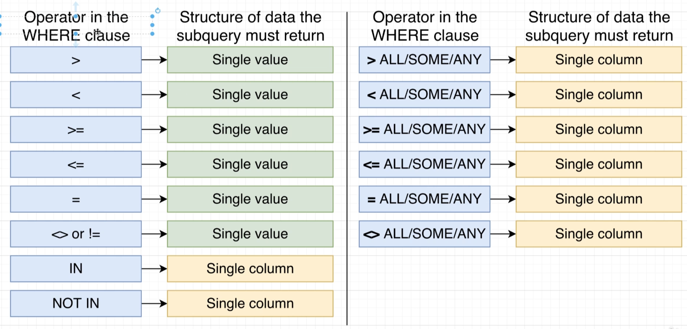
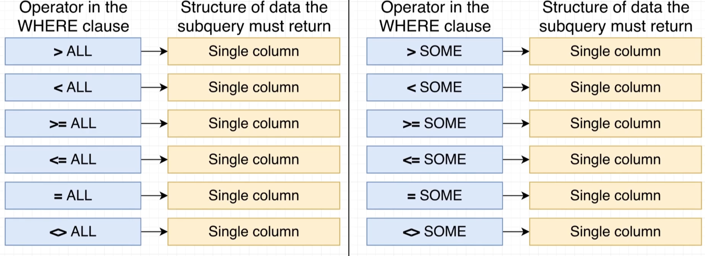

DB Desgin Process

1. What kind of thing are we sorting? - Table Name
2. What properties does this thing have? - Columns
3. What type of data does each of those properties contain? - Datatypes of columns

CREATE TABLE <tableName>(
    col col_datatype
);

INSERT INTO <tableName> (cols) VALUES
(value1),(value2),(value3);

SELECT * FROM <tableName>;

UPDATE <tableName> SET <colname> = <value> WHERE <colname> = <value>;

DELETE FROM <tableName> WHERE <colname> = <value>;

Varchar(x) - Variable length character(text) of length X
INTEGER - Non decimal number from -2billion to +2billion

String Operations:
1. || - Join strings
2. concat()
3. upper() / lower()
4. length()

Types of Relationships:
1. One to Many (User has many Photos)
2. Many to One (Many photos have one User)
3. One to One (One country has ONLY ONE Capitol)
4. Many to Many (Many tasks assigned to Many Engineers)

Primary Keys - Uniquely identifies a row
Foriegn Key - Identifies a record in another table that this row is associated with

NULL is photo referenced with no user.

Delete foriegn Key(user):
    1. ON DELETE RESTRICT - Error
    2. ON DELETE NO ACTION - Error
    3. ON DELETE CASCADE - Delete photos of user
    4. ON DELETE SET NULL - Set NULL
    5. ON DELETE SET DEFAULT - Set default value

TYPES OF JOINS:
1. INNER JOIN - Matching row mandatory
2. LEFT JOIN - All rows of left table
3. RIGHT JOIN - All rows of right table
4. FULL JOIN - Match every row of both table 

AGGREGATE FUNCTION:
- SUM
- MAX
- MIN
- COUNT - Null value ignored
- COUNT(*) - number of rows
- AVG

WHERE - Filters rows
HAVING -Filters groups

UNION - Combine two query results
UNION ALL - Union with duplicates
INTERSECT - Returns rows that are common
EXCEPT - A EXCEPT B, remove rows from A that is present in B. 

SCALAR QUERY - single value from query

SUBQUERIES:
select - single value
from - outer query compatible - alias is IMPORTANT
join - compatible with ON clause
where - in (single column of values)

GREATEST
LEAST

CASE
    WHEN price > 30 THEN "HIGH"
    WHEN price > 30 THEN "HIGH"
    ELSE 'CHEAP
END

